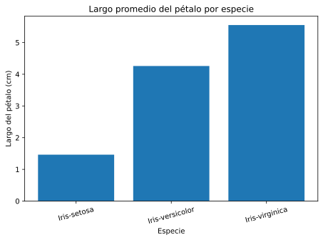

# Prácticas de Práctica Profesionalizante I

En este repositorio dejé respuestas breves a las actividades de los módulos I, II, III y IV. También armé un notebook sencillo para el análisis de datos que pide el módulo IV.

Elegí el conjunto Iris porque es pequeño y tiene mediciones de flores con su especie. La consigna pide revisar variables, conteos, llegar a una conclusión y hacer un gráfico. No agregué un modelo predictivo porque ese punto no lo pide.

## Archivos

- respuestas_practicas.md: respuestas y glosarios.
- notebooks/analisis_iris.ipynb: carga, revisión y gráfico del conjunto Iris.
- grafico_largo_petalo.svg: gráfico que guardé al ejecutar el notebook.
- requirements.txt: librerías que usé.

## Cómo ejecutarlo

1. Instalá las librerías con: pip install -r requirements.txt
2. Abrí Jupyter desde la carpeta del repositorio.
3. Abrí notebooks/analisis_iris.ipynb y ejecutá las celdas en orden.

El notebook descarga el CSV desde UCI, así que necesita conexión a Internet.

## Fuente de datos

Fisher, R. (1936). Iris. UCI Machine Learning Repository.  
https://archive.ics.uci.edu/dataset/53/iris

El conjunto tiene 150 registros y está publicado con licencia CC BY 4.0. Dejé la atribución en este archivo y dentro del notebook.

